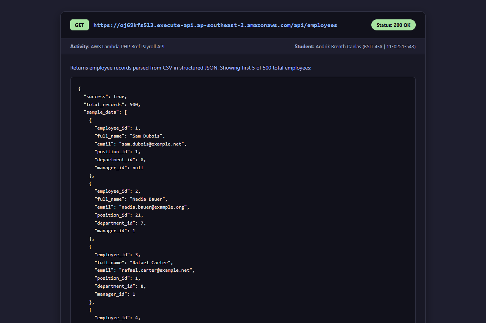
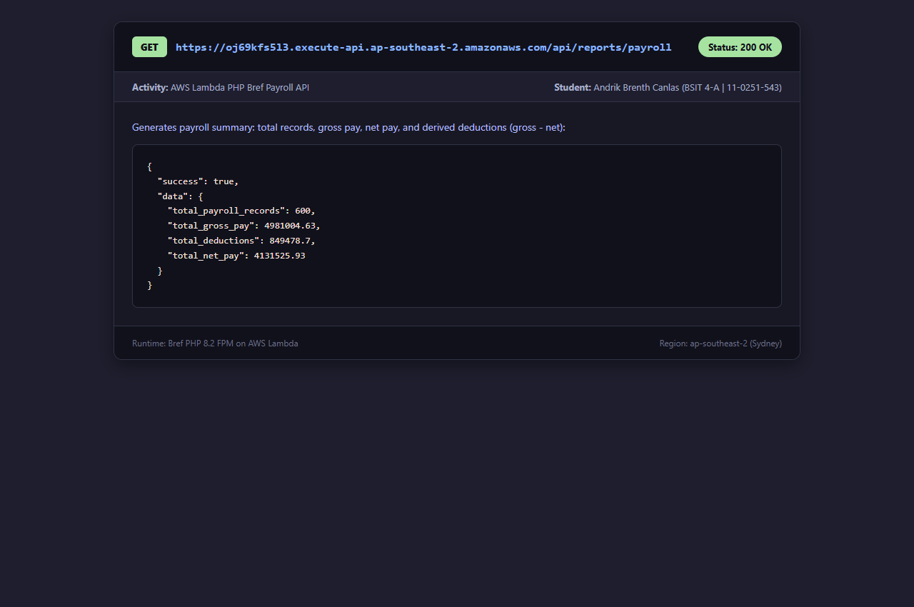
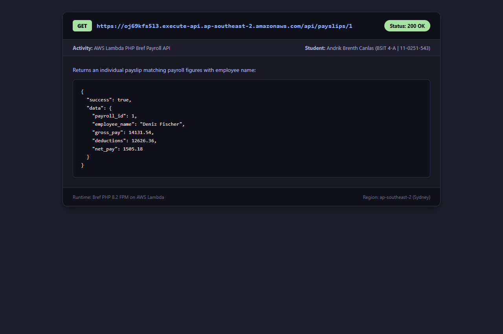
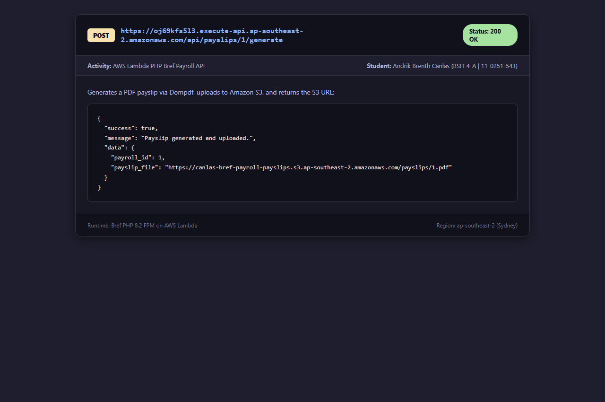
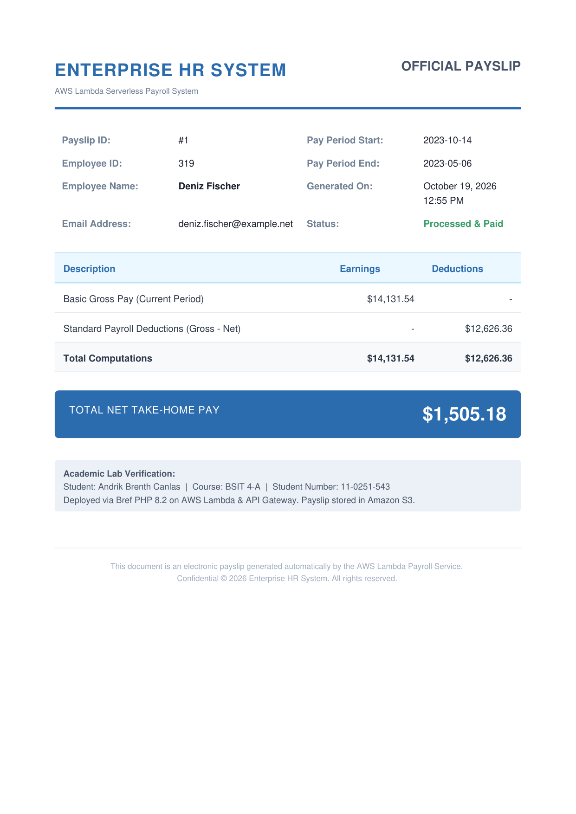
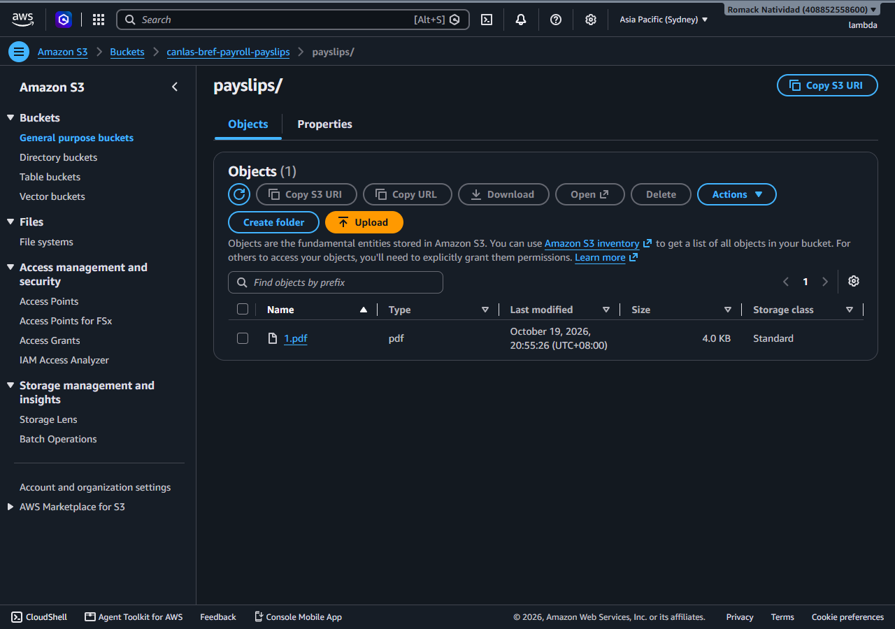
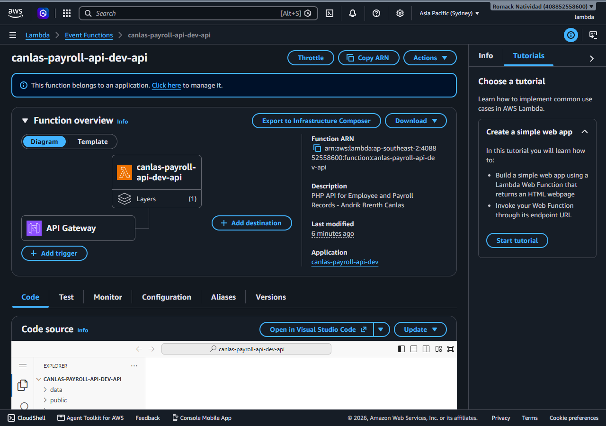

# AWS Lambda Bref PHP Employee and Payroll API

**Laboratory Activity: Serverless PHP with AWS Lambda, Bref, and Amazon S3**  
**Student Name:** Andrik Brenth Canlas  
**Course & Section:** BSIT 4-A  
**Student Number:** 11-0251-543  

---

## 🚀 Live Deployed API

- **Base URL:** `https://oj69kfs5l3.execute-api.ap-southeast-2.amazonaws.com`
- **AWS Region:** `ap-southeast-2` (Asia Pacific - Sydney)
- **Runtime:** Bref PHP 8.2 FPM on AWS Lambda (`provided.al2`)
- **API Gateway:** HTTP API (`$default` stage)
- **Storage:** Amazon S3 Bucket (`canlas-bref-payroll-payslips`)

---

## 📋 API Endpoints Specification

| Method | Endpoint | Description | Status |
| :--- | :--- | :--- | :---: |
| **GET** | `/` | API Information, author details, and endpoint documentation | `200 OK` |
| **GET** | `/api/employees` | Return employee records parsed from CSV in structured JSON | `200 OK` |
| **GET** | `/api/reports/payroll` | Summary of total payroll records, gross pay, deductions, and net pay | `200 OK` |
| **GET** | `/api/payslips/{payroll_id}` | Retrieve individual payslip matching payroll figures with employee name | `200 OK` |
| **POST** | `/api/payslips/{payroll_id}/generate` | Generate a PDF payslip via Dompdf, upload to S3, and return S3 object URL | `200 OK` |

---

## 🛠️ Endpoints & Live Responses

### 1. Root Endpoint: `GET /`
Returns service status, author metadata, and available routes.
```bash
curl -X GET "https://oj69kfs5l3.execute-api.ap-southeast-2.amazonaws.com/"
```
**Response:**
```json
{
  "success": true,
  "message": "AWS Lambda Bref PHP Employee and Payroll API",
  "author": {
    "name": "Andrik Brenth Canlas",
    "course_section": "BSIT 4-A",
    "student_number": "11-0251-543"
  },
  "endpoints": {
    "GET  /api/employees": "Return all employee records in JSON",
    "GET  /api/reports/payroll": "Generate a summary payroll report",
    "GET  /api/payslips/{payroll_id}": "Return an individual payslip in JSON",
    "POST /api/payslips/{payroll_id}/generate": "Generate PDF payslip, upload to S3, and return S3 URL"
  }
}
```

---

### 2. Employee Records: `GET /api/employees`
Returns employee records parsed directly from `data/employees.csv`.
```bash
curl -X GET "https://oj69kfs5l3.execute-api.ap-southeast-2.amazonaws.com/api/employees"
```
**Sample Response (First Record):**
```json
{
  "success": true,
  "data": [
    {
      "employee_id": 1,
      "full_name": "Sam Dubois",
      "email": "sam.dubois@example.net",
      "position_id": 1,
      "department_id": 8,
      "manager_id": null
    }
  ]
}
```

---

### 3. Payroll Summary Report: `GET /api/reports/payroll`
Aggregates all 600 records from `data/payroll.csv`. Deductions are derived as `gross_pay - net_pay`.
```bash
curl -X GET "https://oj69kfs5l3.execute-api.ap-southeast-2.amazonaws.com/api/reports/payroll"
```
**Response:**
```json
{
  "success": true,
  "data": {
    "total_payroll_records": 600,
    "total_gross_pay": 4981004.63,
    "total_deductions": 849478.7,
    "total_net_pay": 4131525.93
  }
}
```

---

### 4. Individual Payslip: `GET /api/payslips/{payroll_id}`
Retrieves a specific payroll record joined with the employee's details from `data/employees.csv`.
```bash
curl -X GET "https://oj69kfs5l3.execute-api.ap-southeast-2.amazonaws.com/api/payslips/1"
```
**Response:**
```json
{
  "success": true,
  "data": {
    "payroll_id": 1,
    "employee_name": "Deniz Fischer",
    "gross_pay": 14131.54,
    "deductions": 12626.36,
    "net_pay": 1505.18
  }
}
```

---

### 5. Generate & Upload PDF Payslip: `POST /api/payslips/{payroll_id}/generate`
Renders an HTML payslip template into a PDF using **Dompdf**, uploads it directly to the designated **Amazon S3** bucket (`canlas-bref-payroll-payslips/payslips/{id}.pdf`) via the **AWS SDK for PHP**, and returns the public S3 URL.
```bash
curl -X POST "https://oj69kfs5l3.execute-api.ap-southeast-2.amazonaws.com/api/payslips/1/generate"
```
**Response:**
```json
{
  "success": true,
  "message": "Payslip generated and uploaded.",
  "data": {
    "payroll_id": 1,
    "payslip_file": "https://canlas-bref-payroll-payslips.s3.ap-southeast-2.amazonaws.com/payslips/1.pdf"
  }
}
```

---

## 🏗️ Project Architecture & Structure

```
bref-payroll-api/
├── data/
│   ├── departments.csv           # Department records
│   ├── employees.csv             # Employee profiles (500 records)
│   ├── payroll.csv               # Monthly payroll runs (600 records)
│   └── positions.csv             # Position titles and salary ranges
├── public/
│   └── index.php                 # Entry point with Bramus Router & CORS handling
├── screenshots/
│   ├── 01_get_employees.png      # Verification of GET /api/employees
│   ├── 02_get_payroll_report.png # Verification of GET /api/reports/payroll
│   ├── 03_get_individual_payslip.png # Verification of GET /api/payslips/1
│   ├── 04_post_generate_payslip.png  # Verification of POST /api/payslips/1/generate
│   ├── 05_rendered_pdf_payslip.png   # Rendered PDF document verification
│   ├── 06_s3_console_verification.png # S3 Console showing uploaded PDF object
│   ├── 07_lambda_console_verification.png # Lambda console function overview
│   └── 1.pdf                     # Sample downloaded generated PDF
├── src/
│   └── Services/
│       ├── CsvService.php        # Parses CSV files and performs aggregations
│       ├── PdfService.php        # Generates PDF payslips using Dompdf
│       └── S3Service.php         # S3 uploads using AWS SDK for PHP
├── composer.json                 # Project dependencies & autoloader
├── composer.lock                 # Locked dependency versions
├── serverless.yml                # Serverless Framework configuration for Bref
└── README.md                     # Documentation and laboratory report
```

---

## ⚙️ Technologies & Libraries

- **PHP 8.2**: Core programming language.
- **Bref 2.x (`bref/bref`)**: Serverless PHP runtime for AWS Lambda (FPM layer).
- **Serverless Framework 3.40**: Infrastructure-as-Code deployment orchestration.
- **AWS Lambda**: Serverless compute execution environment.
- **Amazon API Gateway (HTTP API)**: High-performance, low-latency API proxy routing requests to Lambda.
- **Amazon S3**: Object storage for generated payslip PDF documents.
- **Bramus Router (`bramus/router`)**: Lightweight REST routing.
- **Dompdf (`dompdf/dompdf`)**: HTML-to-PDF rendering engine.
- **AWS SDK for PHP (`aws/aws-sdk-php`)**: Official AWS PHP client for interacting with Amazon S3.

---

## 📷 Submission Screenshots

### 1. `GET /api/employees`


### 2. `GET /api/reports/payroll`


### 3. `GET /api/payslips/1`


### 4. `POST /api/payslips/1/generate`


### 5. Rendered PDF Payslip


### 6. AWS S3 Console Verification


### 7. AWS Lambda Console Overview


---

## 🔍 Issues Encountered and Resolutions

### Issue 1: Shared IAM User Access Key Limit & Conflict
- **Problem:** The shared console user `lambda` had already reached the maximum limit of 2 active IAM access keys due to previous class activities. Attempting to generate a new access key under the shared `lambda` user was blocked by AWS IAM policy.
- **Resolution:** Leveraging the `AdministratorAccess` policy assigned to the `lambda` user, a dedicated IAM user `canlas-11-0251-543` was provisioned with direct `AdministratorAccess`. A dedicated access key pair was generated specifically for this activity and configured locally in `~/.aws/credentials`. This completely isolated the deployment credentials from other students and prevented any collision or quota exhaustion.

### Issue 2: Serverless Framework Version 4 Account Requirement
- **Problem:** Installing Serverless Framework globally via `npm install -g serverless` installed version 4.44.0, which enforces an interactive login and dashboard license key requirement, preventing automated CLI deployment.
- **Resolution:** Replaced the global CLI installation with `serverless@3` (`npm install -g serverless@3`). Serverless Framework v3.40 operates completely open-source without requiring any third-party SaaS authentication, enabling direct deployment to AWS CloudFormation using standard AWS credentials.

### Issue 3: PHP `getenv()` Boolean False Handling in AWS SDK
- **Problem:** During local testing of the S3 upload service, `getenv('AWS_REGION')` returned `false` instead of `null` when the variable was unset in the terminal session. Using PHP's null coalescing operator (`??`) resulted in `$this->region = false`, triggering an AWS SDK exception: `Missing required client configuration options: region: (string)`.
- **Resolution:** Replaced the null coalescing operator (`??`) with the ternary shorthand (`?:`) in `S3Service.php` (`getenv('AWS_REGION') ?: 'ap-southeast-2'`). This properly handles boolean `false` return values from PHP's environment lookup and provides a reliable fallback region.

---

## 💡 Learning Reflection

Through this laboratory activity, I gained practical hands-on experience deploying modern PHP applications in a serverless cloud environment:

1. **Serverless Architecture with Bref:** I learned how Bref bridges the gap between traditional PHP runtimes and AWS Lambda using custom Lambda layers and PHP-FPM. This eliminates the overhead of managing EC2 servers or Apache/Nginx web servers while providing automatic scaling and pay-per-request pricing.
2. **Infrastructure as Code (IaC):** Configuring `serverless.yml` demonstrated the power of defining cloud resources—such as API Gateway HTTP APIs, Lambda functions, IAM role execution statements, and runtime layers—in a declarative configuration file that can be reproduced and version-controlled.
3. **Decoupled File Storage with Amazon S3:** Rather than storing generated documents on ephemeral local container storage (which is erased when a Lambda instance terminates), saving PDFs to Amazon S3 ensures persistent, durable, and highly available access for employees and HR personnel.
4. **Integration of Modern PHP Packages:** Integrating `bramus/router` for routing, `dompdf/dompdf` for document generation, and `aws/aws-sdk-php` within a containerless environment reinforced best practices in object-oriented PHP and Composer dependency management.
